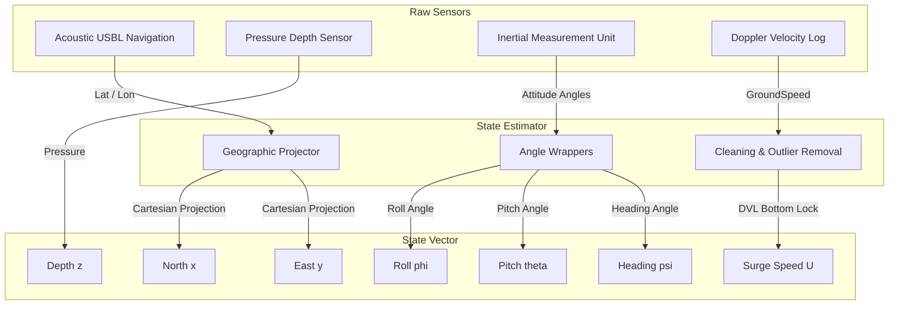

# State Vector Definition

This document outlines the state vector representation, pseudo-control inputs, and coordinate conventions used in the project.

---

## 1. AUV State Vector

The state vector $\mathbf{x} \in \mathbb{R}^7$ represents the full 3D pose and linear velocity of the Autonomous Underwater Vehicle:

$$\mathbf{x} = [x, y, z, \phi, \theta, \psi, U]^T$$

Where:

| State Variable | Symbol | Description | Units | Source |
| :--- | :---: | :--- | :---: | :--- |
| **North Position** | $x$ | Local Cartesian North displacement from reference origin | Meters ($m$) | Derived from GPS/USBL Latitude |
| **East Position** | $y$ | Local Cartesian East displacement from reference origin | Meters ($m$) | Derived from GPS/USBL Longitude |
| **Depth** | $z$ | Vertical distance below sea level (positive-down) | Meters ($m$) | Measured directly by pressure sensor |
| **Roll** | $\phi$ | Rotation about the longitudinal body axis | Radians ($rad$) | Measured directly by IMU |
| **Pitch** | $\theta$ | Rotation about the lateral body axis (positive nose-up) | Radians ($rad$) | Measured directly by IMU |
| **Heading** | $\psi$ | Rotation about the vertical axis clockwise from North | Radians ($rad$) | Measured directly by Gyro/IMU |
| **Surge Speed** | $U$ | Forward linear velocity along the body x-axis | Meters/second ($m/s$) | Measured by Doppler Velocity Log (DVL) |

---

## 2. Pseudo-Control Inputs

Since the raw AURORA telemetry does not log direct low-level thruster actuator speed commands or fin deflections, we formulate the controller around a command vector:

$$\mathbf{u} = [U_c, \theta_c, \psi_c]^T$$

Where:
* $U_c$: Commanded surge velocity ($0.5$ to $1.8$ m/s limit)
* $\theta_c$: Commanded pitch angle ($-0.3$ to $0.3$ rad limit)
* $\psi_c$: Commanded heading angle ($0$ to $2\pi$ rad)

Fin rate constraints are modeled internally in the simulator to limit sudden command changes:
* Max Pitch rate: $\pm0.1$ rad per step (2s)
* Max Yaw rate: $\pm0.2$ rad per step (2s)

---

## 3. Sensor to State Mapping Diagram

