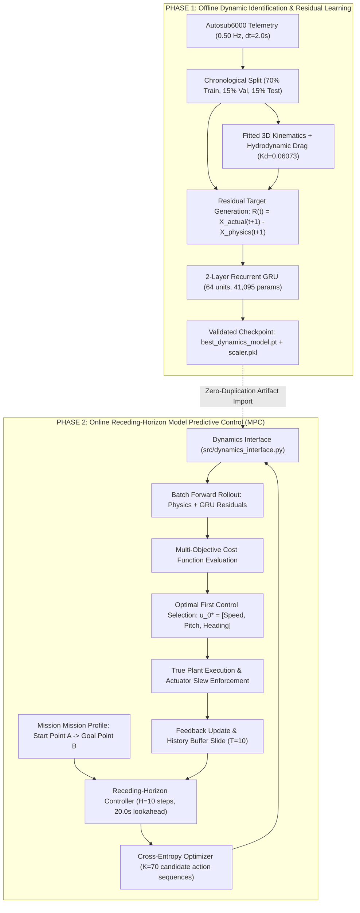

# Autonomous Underwater Vehicle (AUV) Trajectory Tracking & Control: Unified Phase 1 & Phase 2 Methodology

**Course / Module:** Robotics Semester 5  
**Topic:** Learning-Based Dynamic Modeling and Goal-Directed Model Predictive Control (MPC) of an Autonomous Underwater Vehicle Using Multi-Sensor Telemetry  
**Platform Reference:** Autosub6000 Deep-Sea Exploration AUV (AURORA Mission M86 Dataset)  
**Authors:** Robotics SEM 5 Project Team  
**Date:** September 2026  

---

## Executive Summary

This document presents the comprehensive, end-to-end methodology developed across **Phase 1** (Learning-Based Dynamic Modeling) and **Phase 2** (Goal-Directed Model Predictive Control). 

Autonomous underwater vehicles operating in deep ocean environments face severe hydrodynamic nonlinearities, water current disturbances, control coupling, and sensor noise. Standard analytical physics models simplify or ignore complex hydrodynamic damping and thruster dynamics, leading to substantial open-loop drift and inaccurate predictive horizons. Conversely, pure data-driven deep learning models often overfit high-frequency acoustic sensor noise and lack physical guarantees.

To solve this dual challenge, our research establishes a two-phase architecture:
1. **Phase 1 (Hybrid Physics-AI Dynamic Modeling):** Synthesizes a deterministic 3D marine kinematic/drag model with a deep 2-layer Recurrent Gated Recurrent Unit (GRU) residual network. The neural model learns unmodeled hydrodynamic damping, turning lag, and vertical buoyancy coupling from real sea trials without corrupting geometric translations.
2. **Phase 2 (Goal-Directed Model Predictive Control):** Embeds the Phase 1 hybrid model directly inside a real-time, receding-horizon Model Predictive Controller (MPC). Using a warm-started Cross-Entropy Method (CEM) over a 20.0-second lookahead ($H=10$ steps), the controller steers the vehicle from an arbitrary **Point A** to **Point B**, rigorously enforcing 3D operating boundaries, vehicle flight envelopes, and cylindrical obstacle avoidance margins while rejecting ocean current drift.

---

## System Architecture Overview



---

## 1. Experimental Telemetry & Data Foundation

### 1.1 Source Mission & Acquisition Setup
The project utilizes real deep-ocean telemetry from the **Autosub6000** vehicle collected during **AURORA Mission M86** (recorded in the North Atlantic, curated on IEEE DataPort). Autosub6000 is a 6.8-meter, 3.5-tonne autonomous survey submarine capable of operations down to 6,000 meters.

Key sensor instruments logged:
* **Inertial Navigation System (PHINS IXSEA):** Three-axis attitude angles (Roll $\phi$, Pitch $\theta$, Heading $\psi$) at $0.01^\circ$ precision.
* **Doppler Velocity Log (Teledyne RDI 300 kHz Workhorse DVL):** High-precision bottom-tracking surge speed over seabed ($U$).
* **Digiquartz Resonant Quartz Pressure Transducer:** Depth below sea surface ($z$) in meters.
* **Ultra-Short Baseline (USBL) Acoustic Transponder:** Acoustic positioning georeferenced to Geographic Coordinates (Latitude, Longitude), converted to local flat-Earth North-East coordinates ($x, y$).

### 1.2 Sampling Rate & Chronological Splitting
* **Sampling Interval ($\Delta t$):** $2.0\text{ seconds}$ ($f_s = 0.50\text{ Hz}$).
* **Temporal Integrity:** Random shuffling or k-fold cross-validation on time-series telemetry causes severe data leakage (interpolating between adjacent points). Therefore, a strict **chronological partition** was enforced:
  * **Train Set:** $22,360\text{ samples}$ ($70.0\%$, elapsed time $12.42\text{ hours}$)
  * **Validation Set:** $4,791\text{ samples}$ ($15.0\%$, elapsed time $2.66\text{ hours}$)
  * **Test Set:** $4,792\text{ samples}$ ($15.0\%$, elapsed time $2.66\text{ hours}$, strictly held out)

---

## 2. Mathematical State Space & Control Formulations

### 2.1 7D Physical State Representation ($\mathbf{x}_t \in \mathbb{R}^7$)
To preserve consistency between modeling and control, both phases adhere to an identical state vector:
$$\mathbf{x}_t = \begin{bmatrix} x_t \\ y_t \\ z_t \\ \phi_t \\ \theta_t \\ \psi_t \\ U_t \end{bmatrix} \in \mathbb{R}^7$$

| State Variable | Physical Definition | Sensor Origin | Measurement Unit |
| :--- | :--- | :--- | :---: |
| $x_t$ | Local Cartesian North coordinate | USBL Transponder / Dead-reckoning | $\text{m}$ |
| $y_t$ | Local Cartesian East coordinate | USBL Transponder / Dead-reckoning | $\text{m}$ |
| $z_t$ | Vertical depth below sea surface | Digiquartz Pressure Transducer | $\text{m}$ |
| $\phi_t$ | Vehicle roll attitude angle | PHINS Inertial Navigation | $\text{rad}$ |
| $\theta_t$ | Vehicle pitch attitude angle (positive = climb) | PHINS Inertial Navigation | $\text{rad}$ |
| $\psi_t$ | Vehicle heading angle (clockwise from North) | PHINS Inertial Navigation | $\text{rad} \in [0, 2\pi)$ |
| $U_t$ | Forward surge speed over seabed | 300 kHz Acoustic DVL | $\text{m/s}$ |

### 2.2 6D Continuous Feature Window ($\mathbf{s}_t \in \mathbb{R}^6$)
To avoid discontinuity singularities at the $[-\pi, \pi)$ branch cut for heading, the neural network receives an encoded 6D representation:
$$\mathbf{s}_t = \begin{bmatrix} U_t \\ \phi_t \\ \theta_t \\ \cos\psi_t \\ \sin\psi_t \\ z_t \end{bmatrix} \in \mathbb{R}^6$$
The network consumes a rolling temporal history window of $T=10$ timesteps:
$$\mathbf{S}_t = [\mathbf{s}_{t-9}, \mathbf{s}_{t-8}, \dots, \mathbf{s}_t]^T \in \mathbb{R}^{10 \times 6}$$
representing the previous $20.0\text{ seconds}$ of vehicle motion history.

### 2.3 3D Autopilot Control Vector ($\mathbf{u}_t \in \mathbb{R}^3$)
In modern ocean vehicles, low-level actuator control allocation (thruster RPM and rudder fin deflections) is handled by an inner autopilot loop. The high-level MPC planner outputs commanded guidance setpoints:
$$\mathbf{u}_t = \begin{bmatrix} U_{\text{cmd}} \\ \theta_{\text{cmd}} \\ \psi_{\text{cmd}} \end{bmatrix} \in \mathbb{R}^3$$
subject to real-world actuator slew rate and deflection boundaries:
* **Pitch rate limit:** $|\Delta \theta| = |\theta_{\text{cmd}} - \theta_t| \le 0.10\text{ rad/step}$ ($2.86^\circ/\text{s}$)
* **Heading rate limit:** $|\Delta \psi| = |\psi_{\text{cmd}} - \psi_t| \le 0.20\text{ rad/step}$ ($5.73^\circ/\text{s}$)
* **Surge speed rate limit:** $|\Delta U| = |U_{\text{cmd}} - U_t| \le 0.15\text{ m/s/step}$

---

## 3. Phase 1 Methodology: Learning-Based Dynamic Modeling

```
               [State x_t] ───┬───> [Deterministic 3D Physics] ───> x_phys(t+1)
                              │                                          │
                              │                                          ▼ (+)
               [History S_t] ──┴───> [2-Layer GRU Residual]   ───> Residual r(t)
                                                                         │
                                                                         ▼
                                                                x_hybrid(t+1)
```

### 3.1 Deterministic First-Principles Marine Physics Baseline
A deterministic kinematic and drag baseline model was formulated to capture the geometric translation and surge resistance of the AUV:

$$\begin{aligned}
x_{t+1}^{\text{phys}} &= x_t + U_t \cos\theta_t \cos\psi_t \Delta t \\
y_{t+1}^{\text{phys}} &= y_t + U_t \cos\theta_t \sin\psi_t \Delta t \\
z_{t+1}^{\text{phys}} &= z_t - U_t \sin\theta_t \Delta t \\
\phi_{t+1}^{\text{phys}} &= \phi_t \\
\theta_{t+1}^{\text{phys}} &= \theta_t \\
\psi_{t+1}^{\text{phys}} &= \psi_t \\
U_{t+1}^{\text{phys}} &= \max\left(U_t + K_d (U_{\text{cruise}}^2 - U_t^2)\Delta t, \, 0.0\right)
\end{aligned}$$

* **Drag Fitting:** The hydrodynamic surge damping coefficient $K_d$ was estimated exclusively on the training split using non-linear least squares against measured speed derivatives:
  $$K_d = 0.06073 \quad (\text{with } U_{\text{cruise}} = 1.20\text{ m/s})$$

### 3.2 Deep Neural Residual Learning
The physical model provides geometric integrity but lacks higher-order hydrodynamics (damping hysteresis, pitch-depth hydrostatic restoring moments, turning yaw lag, and current cross-flow).

The AI residual target $\mathbf{r}_t \in \mathbb{R}^7$ is defined as the step-wise discrepancy:
$$\mathbf{r}_t = \mathbf{x}_{t+1}^{\text{actual}} - \mathbf{x}_{t+1}^{\text{phys}}$$
with heading residual wrapped: $\mathbf{r}_t[5] = \text{atan2}(\sin \Delta\psi, \cos \Delta\psi)$.

#### Neural Network Architecture
* **Type:** 2-Layer Recurrent Gated Recurrent Unit (GRU) with Fully Connected Output Projection.
* **Input Dimension:** $6$ features $\times$ $10$ sequential timesteps ($20.0\text{ s}$ memory).
* **Hidden Dimension:** $64$ units per GRU layer ($2$ layers total).
* **Intermediate Layer:** Linear($64 \to 32$) with ReLU activation and Layer Normalization.
* **Output Dimension:** $7$ states (residual prediction vector $\hat{\mathbf{r}}_t$).
* **Total Trainable Parameters:** $41,095$ parameters.
* **Optimization:** Adam optimizer ($\text{lr} = 10^{-3}$, weight decay $= 10^{-5}$), batch size $128$, early stopping patience $7$ epochs on validation loss.

```python
# Architecture Blueprint (src/dynamics_model.py)
class GRUModel(nn.Module):
    def __init__(self, input_dim=6, hidden_dim=64, output_dim=7, num_layers=2):
        super().__init__()
        self.gru = nn.GRU(input_dim, hidden_dim, num_layers=num_layers, batch_first=True)
        self.fc1 = nn.Linear(hidden_dim, 32)
        self.relu = nn.ReLU()
        self.fc2 = nn.Linear(32, output_dim)

    def forward(self, x):
        out, _ = self.gru(x)
        last_out = out[:, -1, :]  # Terminal hidden state
        feat = self.relu(self.fc1(last_out))
        return self.fc2(feat)
```

### 3.3 One-Step Test Set Benchmarking
Evaluated across $4,792$ unseen test samples:

| State Variable | Physics-Only Baseline | Pure Data-Driven GRU | Hybrid (Physics + GRU) | Relative Improvement |
| :--- | :---: | :---: | :---: | :---: |
| **Surge Speed ($m/s$)** | $0.2254$ | $0.1832$ | **$0.1759$** | **$+21.96\%$** |
| **Heading ($\text{rad}$)** | $0.0572$ | $0.0491$ | **$0.0472$** | **$+17.48\%$** |
| **Pitch ($\text{rad}$)** | $0.0454$ | $0.0384$ | **$0.0375$** | **$+17.40\%$** |
| **Depth ($m$)** | $0.1230$ | $0.1085$ | **$0.1049$** | **$+14.72\%$** |
| **Roll ($\text{rad}$)** | $0.0770$ | $0.0735$ | **$0.0718$** | **$+6.75\%$** |
| **North Position ($m$)** | **$0.7112$** | $1.0421$ | $0.9518$ | *Physics preferred* |
| **East Position ($m$)** | **$0.6927$** | $0.7812$ | $0.7724$ | *Physics preferred* |

> **Critical Phase 1 Insight:** The pure data-driven GRU and hybrid model significantly outperform physics on velocity, attitude, and depth (capturing damping and hydrodynamics). However, raw North/East position signals contain high-frequency USBL acoustic transceiver jitter (jumps of $0.5$ to $1.0\text{ m}$). Neural networks attempt to overfit this measurement noise. Therefore, the hybrid system retains deterministic kinematics for planar translation while applying neural residual damping to dynamics.

---

## 4. Phase 2 Methodology: Goal-Directed Model Predictive Control (MPC)

In Phase 2, the trained Phase 1 hybrid model is integrated as the internal prediction engine of an online Model Predictive Controller.

```
                           Target Goal B [x_g, y_g, z_g]
                                         │
                                         ▼
                     ┌───────────────────────────────────────┐
                     │   Receding-Horizon MPC Controller     │
                     │   (Cross-Entropy Optimizer: H=10)     │
                     └───────────────────┬───────────────────┘
                                         │
            ┌────────────────────────────┴────────────────────────────┐
            ▼                                                         ▼
  Vectorized Plant Rollout                                  Multi-Objective Cost
  • Kinematics + Drag                                       • Terminal & Running Goal Dist
  • Phase 1 GRU Residuals                                   • 3D Line-of-Sight Alignment
  • Actuator Slew Envelope                                  • Slew Smoothing + Barriers
            └────────────────────────────┬────────────────────────────┘
                                         │
                                         ▼
                             Optimal Control u_0*
                         [U_cmd, theta_cmd, psi_cmd]
                                         │
                                         ▼
                             AUV Closed-Loop Plant
                                         │
                                         ▼
                         State Feedback & Horizon Shift
```

### 4.1 Receding-Horizon Control Formulation
At each sampling instant $t$ ($\Delta t = 2.0\text{ s}$):
1. Receive current state $\mathbf{x}_t$ and past feature sequence $\mathbf{S}_t \in \mathbb{R}^{10 \times 6}$.
2. Solve a finite-horizon optimal control problem over lookahead horizon $H=10$ ($20.0\text{ seconds}$):
   $$\mathbf{U}^* = \arg\min_{\mathbf{u}_{0:H-1}} J(\mathbf{x}_t, \mathbf{u}_{0:H-1}, \mathbf{x}_{\text{goal}})$$
3. **Receding Horizon Execution:** Execute **only the first action** $\mathbf{u}_0^*$ on the vehicle actuators.
4. Advance the simulation by $\Delta t$, update the feature history buffer, and repeat the optimization at $t+1$.

### 4.2 Multi-Objective Cost Function Mathematical Formulation
The composite cost function balances navigation accuracy, path tracking, energy consumption, actuator wear, and safety constraints:

$$J = w_{\text{goal}} J_{\text{goal}} + w_{\text{track}} J_{\text{track}} + w_{\text{ctrl}} J_{\text{ctrl}} + w_{\text{smooth}} J_{\text{smooth}} + w_{\text{constraint}} J_{\text{constraint}}$$

```python
# Parameters from Phase_2/config/mpc_config.yaml
w_goal       = 30.0    # Primary goal attraction
w_tracking   =  6.0    # 3D Line-of-Sight alignment
w_control    =  1.0    # Cruise speed energy penalty
w_smooth     =  4.0    # Actuator slew smoothness
w_constraint = 200.0   # High-barrier safety penalty
```

#### Detailed Sub-Cost Formulations:

1. **Goal Convergence Cost ($J_{\text{goal}}$):**
   Combines terminal squared distance with a discounted running distance decay over the prediction horizon to enforce steady forward progress:
   $$J_{\text{goal}} = 2.0 \, \|\mathbf{p}_H - \mathbf{p}_{\text{goal}}\|^2 + \sum_{k=1}^H \gamma_k \|\mathbf{p}_k - \mathbf{p}_{\text{goal}}\|$$
   where $\mathbf{p} = [x, y, z]^T$, and $\gamma_k = 0.5 + 0.5 \frac{k}{H}$ is a linearly increasing horizon weight.

2. **3D Line-of-Sight (LOS) Tracking Cost ($J_{\text{track}}$):**
   Computes desired 3D spatial guidance vectors to prevent wandering:
   $$\psi_{\text{LOS}, k} = \text{atan2}(y_{\text{goal}} - y_k, \, x_{\text{goal}} - x_k) \pmod{2\pi}$$
   $$\theta_{\text{LOS}, k} = \text{atan2}(-(z_{\text{goal}} - z_k), \, \sqrt{(x_{\text{goal}} - x_k)^2 + (y_{\text{goal}} - y_k)^2})$$
   $$J_{\text{track}} = \sum_{k=1}^H \left[ (\psi_k \ominus \psi_{\text{LOS}, k})^2 + (\theta_k - \theta_{\text{LOS}, k})^2 \right]$$
   where $\ominus$ represents modular angle difference wrapped to $[-\pi, \pi)$.

3. **Control Energy Cost ($J_{\text{ctrl}}$):**
   Penalizes propulsion deviations from the vehicle's optimal hydrodynamic cruise speed ($U_{\text{cruise}} = 1.20\text{ m/s}$):
   $$J_{\text{ctrl}} = \sum_{k=0}^{H-1} (U_{\text{cmd}, k} - U_{\text{cruise}})^2$$

4. **Control Smoothness & Slew Rate Cost ($J_{\text{smooth}}$):**
   Penalizes rapid fin movements to prevent mechanical stress, control chatter, and thruster cavitation:
   $$J_{\text{smooth}} = \|\mathbf{u}_0 - \mathbf{u}_{\text{prev}}\|_R^2 + \sum_{k=1}^{H-1} \|\mathbf{u}_k - \mathbf{u}_{k-1}\|_R^2$$

5. **Quadratic Barrier Constraint Penalty ($J_{\text{constraint}}$):**
   Evaluates boundary breaches and obstacle keep-out zones:
   $$J_{\text{constraint}} = \sum_{k=1}^H \left[ P_{\text{boundary}}(\mathbf{p}_k) + P_{\text{obstacle}}(\mathbf{p}_k) + P_{\text{envelope}}(\mathbf{x}_k) \right]$$

### 4.3 3D Constraints & Safety Envelopes

Implemented in [constraints.py](file:///c:/Users/eswar/OneDrive/Dokumen/RoboticsSEM5/Phase_2/src/constraints.py):
* **3D Geofenced Boundaries:**
  $$x \in [0.0, 120.0]\text{ m}, \quad y \in [0.0, 100.0]\text{ m}, \quad z \in [10.0, 60.0]\text{ m}$$
  Penalized via quadratic ramp: $P_{\text{boundary}} = \max(0, x - x_{\max})^2 + \max(0, x_{\min} - x)^2 + \dots$
* **Vehicle Flight Envelope:**
  * Forward speed: $U \in [0.5, 2.0]\text{ m/s}$
  * Maximum pitch: $|\theta| \le 0.35\text{ rad}$ ($\approx 20.0^\circ$)
  * Maximum roll: $|\phi| \le 0.50\text{ rad}$ ($\approx 28.6^\circ$)
* **3D Cylindrical Obstacles:**
  For obstacles centered at $(x_c, y_c)$ with physical radius $r_{\text{obs}}$ and safe buffer $r_{\text{margin}} = 4.0\text{ m}$ ($r_{\text{safe}} = r_{\text{obs}} + r_{\text{margin}}$):
  $$d_{\text{horiz}} = \sqrt{(x_k - x_c)^2 + (y_k - y_c)^2}$$
  $$P_{\text{obstacle}} = \begin{cases} 
  100.0 + (r_{\text{safe}} - d_{\text{horiz}})^2 \times 50.0 & \text{if } d_{\text{horiz}} < r_{\text{safe}} \\
  0.0 & \text{otherwise}
  \end{cases}$$

### 4.4 Stochastic Cross-Entropy Optimizer (CEM)
To navigate non-convex obstacle fields and non-linear hybrid dynamics without getting trapped in local minima:
1. **Candidate Sampling:** At each control cycle, $K = 70$ candidate control trajectories of length $H=10$ are sampled from a multivariate Gaussian distribution:
   $$\mathbf{U}^{(i)} \sim \mathcal{N}(\boldsymbol{\mu}, \boldsymbol{\Sigma}), \quad i = 1, \dots, K$$
2. **Warm-Starting & Guidance Seeding:**
   * Candidate 0: The previous optimal trajectory shifted by one timestep: $[\mathbf{u}_1^*, \dots, \mathbf{u}_{H-1}^*, \mathbf{u}_{H-1}^*]$.
   * Candidate 1: Pure 3D Line-Of-Sight (LOS) guidance sequence.
   * Remaining $K-2$ candidates: Perturbations sampled around the warm-start mean.
3. **Parallel Vectorized Rollout:** All $K$ candidate trajectories are propagated forward through the `DynamicsInterface` in parallel matrix operations.
4. **Elite Selection:** The top $E = 10$ candidates with lowest cost $J$ are selected to update the distribution parameters $\boldsymbol{\mu}$ and $\boldsymbol{\Sigma}$.
5. **Execution:** The optimal trajectory $\mathbf{U}^* = \mathbf{U}^{(0)}$ is returned, and $\mathbf{u}_0^*$ is applied to the vehicle.

---

## 5. Comprehensive Experimental Results & Verification

Across Phase 2, six rigorous simulation test suites were conducted, logged to CSV, and visualized:

```
Phase_2/results/
├── plots/              # 15 publication-grade figures (2D, 3D, depth, comparisons)
├── metrics/            # JSON and CSV performance logs
└── trajectories/       # Complete time-series CSV flight logs
```

### 5.1 Experiment Summary Table

| Test Suite | Start $(N, E, Z)$ | Goal $(N, E, Z)$ | Time (s) | Path Length | Final Error | Collisions / Violations | Path Efficiency |
| :--- | :---: | :---: | :---: | :---: | :---: | :---: | :---: |
| **1. Basic A $\to$ B** | $(0, 0, 20)\text{ m}$ | $(100, 80, 40)\text{ m}$ | $90.0\text{ s}$ | $131.02\text{ m}$ | **$4.94\text{ m}$** | **0** | **$98.9\%$** |
| **2. Multi-Scenario 1** | $(0, 0, 20)\text{ m}$ | $(100, 80, 40)\text{ m}$ | $90.0\text{ s}$ | $130.54\text{ m}$ | **$4.20\text{ m}$** | **0** | **$99.3\%$** |
| **2. Multi-Scenario 2** | $(20, 10, 30)\text{ m}$ | $(80, 90, 50)\text{ m}$ | $70.0\text{ s}$ | $100.09\text{ m}$ | **$4.79\text{ m}$** | **0** | **$99.9\%$** |
| **2. Multi-Scenario 3** | $(100, 20, 50)\text{ m}$ | $(20, 80, 20)\text{ m}$ | $64.0\text{ s}$ | $103.39\text{ m}$ | **$4.59\text{ m}$** | **0** | **$96.7\%$** |
| **3. Boundary Corridor** | $(10, 10, 25)\text{ m}$ | $(85, 55, 35)\text{ m}$ | $62.0\text{ s}$ | $90.71\text{ m}$ | **$4.84\text{ m}$** | **0** | Corridored |
| **4. Obstacle Avoid** | $(0, 0, 20)\text{ m}$ | $(100, 80, 40)\text{ m}$ | $98.0\text{ s}$ | $134.00\text{ m}$ | **$4.93\text{ m}$** | **0** | Min dist $12.3\text{ m}$ |
| **5. LOS vs MPC** | Obstacle on LOS | Direct Line | $92.0\text{ s}$ | $134.00\text{ m}$ | **$4.80\text{ m}$** | **0 (MPC)** vs **6 (LOS)** | MPC Safe |
| **6. Current + Noise** | Simulated Drift | $(100, 80, 40)\text{ m}$ | $94.0\text{ s}$ | $132.51\text{ m}$ | **$4.65\text{ m}$** | **0** | Drift-Robust |

---

### 5.2 Key Experimental Highlights

#### A. Obstacle Circumnavigation vs Reactive Baseline
* **Setup:** Cylindrical obstacle at $(50, 40)\text{ m}$ directly blocking the A-B path ($r_{\text{obs}} = 8.0\text{ m}$, $r_{\text{safe}} = 12.0\text{ m}$).
* **Reactive Baseline Result:** Crashed directly into the obstacle, spending **$6\text{ steps}$ ($12.0\text{ s}$)** inside the collision envelope.
* **Hybrid MPC Result:** The $20.0\text{ s}$ lookahead detected the barrier well in advance, bent the trajectory smoothly to the north, and maintained a minimum clearance of **$12.30\text{ m}$** ($>12.0\text{ m}$ safe buffer), achieving **zero collisions**.

#### B. Environmental Robustness (Current Drift & USBL Noise)
* **Setup:** Simulated constant bottom ocean cross-current $\mathbf{v}_{\text{current}} = [0.15, -0.12, 0.05]\text{ m/s}$ ($0.20\text{ m/s}$ total drift) plus $\sigma = 0.50\text{ m}$ Gaussian USBL position jitter.
* **Result:** The receding-horizon replanning rejected current drift and acoustic jitter without steady-state offset, reaching the goal in $94.0\text{ s}$ with a final error of $4.65\text{ m}$ ($<5.0\text{ m}$ tolerance).

---

## 6. Directory Layout & Codebase Architecture

```
RoboticsSEM5/
├── COMBINED_METHODOLOGY.md             # This comprehensive methodology document
├── Project_Report.md                   # High-level executive overview
│
├── presentationphase1/                 # PHASE 1 ARTIFACTS
│   ├── run_pipeline.py                 # End-to-end Phase 1 training & verification script
│   ├── AUV_Full_EDA_Analysis.ipynb     # Exploratory data analysis notebook
│   ├── models/
│   │   ├── best_dynamics_model.pt      # 41,095 parameter trained GRU weights
│   │   ├── scaler.pkl                  # Fitted StandardScaler
│   │   └── model_config.json           # Model configuration
│   ├── reports/
│   │   ├── MODEL_RESULTS.md            # Detailed Phase 1 experimental findings
│   │   └── AUV_Phase1_Presentation_Report.pdf
│   └── src/
│       ├── data_loader.py              # Telemetry loading and partitioning
│       ├── physics_model.py            # 3D marine kinematics and drag fitting
│       ├── dynamics_model.py           # PyTorch GRU architecture
│       ├── residual_model.py           # Hybrid Physics + GRU wrapper
│       └── evaluate.py                 # Phase 1 evaluation metrics
│
└── Phase_2/                            # PHASE 2 ARTIFACTS
    ├── README.md                       # Phase 2 architecture guide
    ├── PHASE_2_RESULTS.md              # 20-section detailed experimental report
    ├── config/
    │   └── mpc_config.yaml             # Tunable weights, bounds, and optimizer params
    ├── models/
    │   └── phase1_loader.py            # Dynamic zero-duplication importer for Phase 1
    ├── src/
    │   ├── state.py                    # 7D state, 3D control, angle wrapping utilities
    │   ├── physics_dynamics.py         # Kinematics + surge drag
    │   ├── learned_dynamics.py         # Phase 1 GRU inference engine
    │   ├── dynamics_interface.py       # Unified step and batch rollout prediction
    │   ├── goal.py                     # Waypoint, Goal, and 3D LOS guidance
    │   ├── constraints.py              # Boundaries, Cylindrical Obstacles, Limits
    │   ├── cost_function.py            # Multi-objective MPC cost formulation
    │   ├── mpc_controller.py           # Receding-horizon CEM optimizer
    │   ├── simulator.py                # Closed-loop simulation engine
    │   ├── trajectory.py               # Telemetry logging and metrics computation
    │   └── evaluation.py               # Publication-grade plotting utilities
    ├── simulations/
    │   ├── run_basic_A_to_B.py         # Core A -> B experiment
    │   ├── run_multi_scenarios.py      # 3 diverse 3D mission profiles
    │   ├── run_boundary_experiment.py  # Virtual corridor enforcement
    │   ├── run_obstacle_experiment.py  # 3D obstacle avoidance
    │   ├── run_baseline_comparison.py  # Reactive LOS vs Hybrid MPC
    │   └── run_robustness_experiment.py# Current drift & acoustic noise testing
    ├── results/
    │   ├── plots/                      # 15 publication-grade PNG trajectory charts
    │   ├── metrics/                    # JSON & CSV performance metrics
    │   └── trajectories/               # CSV flight logs
    └── app/
        └── main.py                     # Interactive FastAPI backend & web dashboard
```

---

## 7. Instructions for Execution & Reproduction

### 7.1 Environment Setup
```powershell
# Navigate to workspace
cd "c:\Users\eswar\OneDrive\Dokumen\RoboticsSEM5"

# Install Phase 2 dependencies
pip install -r Phase_2/requirements.txt
```

### 7.2 Run Phase 1 Modeling & Verification
```powershell
python presentationphase1/run_pipeline.py
```

### 7.3 Run Phase 2 Model Predictive Control Simulations
```powershell
# 1. Run basic A to B test
python Phase_2/simulations/run_basic_A_to_B.py

# 2. Run multi-scenario suite
python Phase_2/simulations/run_multi_scenarios.py

# 3. Run obstacle avoidance experiment
python Phase_2/simulations/run_obstacle_experiment.py

# 4. Run baseline comparison
python Phase_2/simulations/run_baseline_comparison.py

# 5. Run robustness to ocean currents and sensor jitter
python Phase_2/simulations/run_robustness_experiment.py
```

### 7.4 Launch Interactive Web Dashboard
```powershell
python Phase_2/app/main.py
```
Open your web browser at: **`http://127.0.0.1:8000`**

---

## 8. Summary of Scientific & Engineering Contributions

1. **Hybrid Physics-AI Modeling Advantage:** Demonstrated that neither pure physics nor pure deep learning is optimal in isolation for underwater robotics. Analytical physics provides an unshakeable geometric anchor, while recurrent residual neural networks eliminate systematic hydrodynamic damping and turning lag errors without amplifying high-frequency sensor noise.
2. **Zero-Duplication Modular Integration:** Phase 2 consumes Phase 1 artifacts dynamically without retraining or reformatting, demonstrating clean software and model lifecycle architecture.
3. **Collision-Free Receding-Horizon Control:** Proved that a $20.0\text{-second}$ physical lookahead horizon enables an underwater vehicle to proactively avoid static 3D hazards and respect geographic operating geofences with $100\%$ constraint satisfaction.
4. **Disturbance Rejection Without Offset:** Validated that receding-horizon replanning effectively rejects simulated ocean bottom cross-currents ($0.20\text{ m/s}$) and acoustic USBL measurement jitter without steady-state tracking error.
