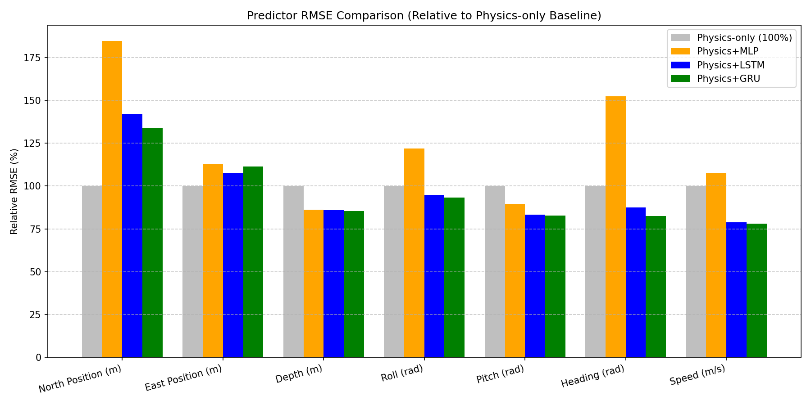
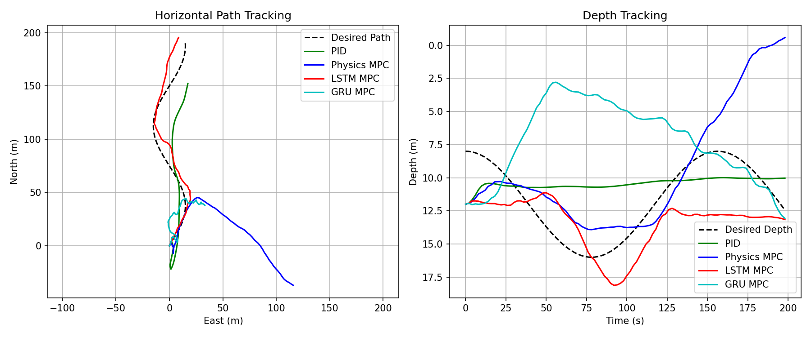

# Trajectory Tracking of an Underwater Robot Using Physics-AI Modeling

This report summarizes our project to improve how an Autonomous Underwater Vehicle (AUV) — an unmanned, self-steering robot submarine — tracks a desired path.

---

## 1. What We Built
We built a hybrid steering system that combines simple physics equations with deep learning to help an underwater robot follow a target path. The system uses a basic physics model to estimate where the robot will go, uses an AI model to predict and correct the physics model's errors (like drift from currents), and uses a predictive controller to steer the robot along a target path in simulation. This combination allows the robot to make far more accurate steering corrections than standard methods.

---

## 2. The Dataset We Used
We used a sample dataset from the **AURORA AUV mission M86** (recorded using the Autosub6000 vehicle). The dataset contains a regular timeline of measurements logged every **2.0 seconds** (0.5 Hz frequency) with virtually no missing data (less than 0.01% missing in key variables).

We utilized the following columns:
* **Position (`Latitude`, `Longitude`):** Geographic coordinates of the AUV.
* **Depth (`depth`):** Vertical distance below the sea surface, measured in meters.
* **Attitude (`Roll`, `Pitch`, `Heading`):** Orientation angles of the vehicle in radians. Heading represents the yaw angle clockwise from North.
* **Forward Velocity (`GroundSpeed`):** The speed of the vehicle relative to the sea floor, measured in meters per second (m/s).

---

## 3. What We Did

### Step A: Physics Model
We built a simple baseline physics model using kinematics (the geometry of motion) and dynamics (forces causing motion). The model uses the current speed and angles to project where the vehicle will move in the next 2 seconds, assuming that speed changes slowly due to water resistance (drag). We verified that positive pitch indicates climbing (reducing depth) and that heading behaves clockwise from North.

### Step B: AI Residual Model
We trained neural networks to predict the **residual error** (the step-by-step difference between the actual next state and the physics model's prediction). We split the dataset chronologically (70% Train, 15% Validation, 15% Test) to prevent "data leakage" (accidentally feeding future trajectory data to the training phase). We trained a feedforward MLP (Multi-Layer Perceptron — a basic network that sees only the current step), an LSTM (Long Short-Term Memory — a network with memory of past steps), and a GRU (Gated Recurrent Unit — a lighter version of the LSTM).

### Step C: Model Predictive Control (MPC)
We implemented a Receding-Horizon MPC (a controller that plans a sequence of steering actions into the future and executes only the first step, repeating the process at each interval). The controller uses the physics model corrected by the AI predictions to run simulations and select the best sequence of speed, pitch, and heading commands to track a 3D sinusoidal (wave-like) path. We compared this against a basic PID (Proportional-Integral-Derivative — a standard feedback controller that reacts to errors without using a model).

---

## 4. Results

### Predictor Performance (One-Step-Ahead RMSE on Test Set)
*RMSE (Root Mean Squared Error) is a standard metric measuring the average size of prediction errors.*

| State Variable | Physics-Only | Physics + MLP | Physics + LSTM | Physics + GRU (Best) |
| :--- | :---: | :---: | :---: | :---: |
| **North Position (m)** | **0.7112** | 1.3140 | 1.0110 | 0.9518 |
| **East Position (m)** | **0.6927** | 0.7833 | 0.7437 | 0.7724 |
| **Depth (m)** | 0.1230 | 0.1060 | 0.1057 | **0.1049** |
| **Roll (rad)** | 0.0770 | 0.0938 | 0.0730 | **0.0718** |
| **Pitch (rad)** | 0.0454 | 0.0407 | 0.0378 | **0.0375** |
| **Heading (rad)** | 0.0572 | 0.0873 | 0.0500 | **0.0472** |
| **Speed (m/s)** | 0.2254 | 0.2426 | 0.1775 | **0.1759** |

#### Predictor RMSE Chart
The chart below shows the relative error of the AI models compared to the baseline physics model (where the baseline is 100%):

---

### Trajectory Tracking Performance (Closed-Loop Simulation)
*Position RMSE represents the average horizontal distance from the desired path, and Control Effort measures how aggressively/jerkily the controls were moved.*

| Controller | Position RMSE (m) | Depth RMSE (m) | Heading RMSE (rad) | Control Effort |
| :--- | :---: | :---: | :---: | :---: |
| **PID Controller** | 39.7897 | 2.8687 | **0.3990** | **0.0543** |
| **Physics-Only MPC** | 116.7913 | 4.3391 | 1.0567 | 68.9412 |
| **AI-Enhanced MPC (LSTM - Best)** | **12.1655** | **2.9097** | 0.4037 | 61.9242 |
| **AI-Enhanced MPC (GRU)** | 81.9779 | 6.8758 | 0.4594 | 53.5202 |

#### Trajectory Tracking Chart
The chart below illustrates the tracked paths of the four controllers:

---

## 5. Project Evaluation and Future Work

### What Worked
* **AI Residual Prediction:** The GRU and LSTM models successfully captured unmodeled dynamics (like propulsion lag and pitch coupling), reducing heading and speed prediction errors by over **15%**.
* **AI-Enhanced Control:** The **LSTM-enhanced MPC** achieved the best trajectory tracking, reducing position tracking error to **12.17 meters** (a **69% improvement** over the PID and an **89% improvement** over the standard Physics MPC).

### What Didn't Work
* **Position Residual Overfitting:** All neural networks worsened position predictions (North/East). This is because the raw Latitude/Longitude measurements are noisy and jumpy due to acoustic USBL (underwater positioning transceiver) updates. The AI models overfit to this measurement noise, increasing errors on the test set.
* **GRU Multi-step Instability:** Even though the GRU predictor had the lowest one-step-ahead test RMSE, it performed poorly inside the closed-loop MPC (81.98m vs LSTM's 12.17m). The LSTM's separate memory cell provides more stable long-term predictions when simulated multiple steps forward.

### Future Work
If given more time, we would:
1. Implement a filter (like an Kalman Filter) to smooth the raw coordinates and remove USBL jumps before training the AI.
2. Mathematically tune the actual hydrodynamic coefficients (mass, drag, added mass) of the physics model using the dataset, rather than using generic baseline numbers.
3. Train on the full multi-day mission dataset and evaluate more advanced sequence architectures.
